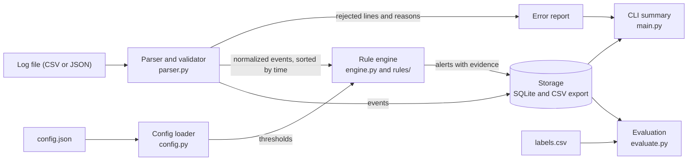

# Design

This document describes how the Security Log Analyzer is organised: the stages a log file goes through, what each module does, and how the parts connect. Field-level details are in `data_dictionary.md` (input fields, validation, thresholds, labelling) and `event_format.md` (the normalized event). They are linked here, not copied.

## 1. Pipeline overview

1. **Read and validate.** The parser reads the input file (CSV or JSON) and checks every line.
2. **Normalize.** Accepted lines become normalized events, sorted by time. Rejected lines go to an error report.
3. **Detect.** The rule engine applies rules R1 to R5 to the events, using thresholds from the config file.
4. **Alert.** Each match produces an alert with evidence (the line numbers of the events that caused it).
5. **Store.** Events and alerts are saved to SQLite, and alerts can be exported to CSV.
6. **Report.** The command-line interface prints a summary.
7. **Evaluate.** `evaluate.py` compares the alerts with the hand-made `labels.csv` and calculates the metrics.

## 2. Modules

| Module | Purpose | Owner |
|---|---|---|
| `config.py` | Loads thresholds from the config file and checks that the values are valid | Alishba |
| `parser.py` | Reads the input, validates each line, produces normalized events and an error report | Alishba |
| `storage.py` | Saves events and alerts to SQLite and exports alerts to CSV | Alishba |
| `main.py` | Command-line interface: reads `--input` and `--config`, runs the pipeline, prints the summary | Alishba |
| `generate_logs.py`, `benchmark.py` | Create the larger labelled dataset and measure processing time | Alishba |
| `alerts.py` | Alert structure and alert IDs | Faizullah |
| `engine.py`, `rules/` | Rules R1 to R5 and the function that runs them on the events | Faizullah |
| `evaluate.py` | Compares alerts with labels and calculates precision, recall, F1 and false positive rate | Faizullah |

All code is in `src/loganalyzer/`. Tests are in `tests/`.

## 3. Data passed between the modules

**Normalized event.** One per accepted line, with the fields `raw_line_no`, `timestamp` (a datetime inside the program, text `YYYY-MM-DD HH:MM:SS` when saved), `source`, `event_type`, `username`, `source_ip` and `message`. The rules never read `message`. See `event_format.md`.

**Events list.** The parser returns the events sorted by `timestamp`, so the rules always receive them in time order.

**Alert.** The alert fields and the severity table are defined in `alert_format.md`. `storage.py` follows that format.

**Config.** Thresholds and time windows for each rule, in `config.json` (final evaluation) and `config_sample.json` (small sample tests).

## 4. Architecture diagram

Reading the diagram: the parser is the only part that touches the raw file. Everything after it works on clean events. The rule engine gets its numbers from the config loader, so thresholds can change without changing code.

## 5. Error handling

- A line that cannot be accepted (bad timestamp, bad IP, missing required field, wrong number of columns, empty row) is rejected and never stops the program.
- Each rejected line is recorded with its line number and the reason.
- The parser reports how many lines were read, accepted and rejected.
- A missing or invalid config file stops the program with a clear message.
- A bad input file (missing, unreadable, invalid JSON) stops the program with a clear message instead of a crash.

## 6. Storage

SQLite database with two tables, `events` and `alerts`. Alerts can also be exported to CSV. Each alert refers to its events through their `raw_line_no`, so an analyst can go from an alert back to the original lines.

## 7. Rules and alerts

(Short section to be added by Faizullah: what each rule detects and how alerts are created. Details are in `rules.md` and `alert_format.md`.)

## 8. Design decisions

- **Thresholds in a config file:** numbers can be changed without editing code, and the small sample tests and the final evaluation can use different settings.
- **Rules ignore the message text:** detection depends on event patterns, so results do not depend on the wording in the data.
- **Parser and rules are separate:** the parser can be tested alone, and the rules receive clean events.
- **Rejected lines are reported, not hidden:** an analyst can see which input could not be used.
- **SQLite for storage:** one file, no server, part of Python's standard library.
- **One owner per file:** parser, storage, config and CLI belong to one member and rules, alerts and evaluation to the other, so pull requests do not clash.
